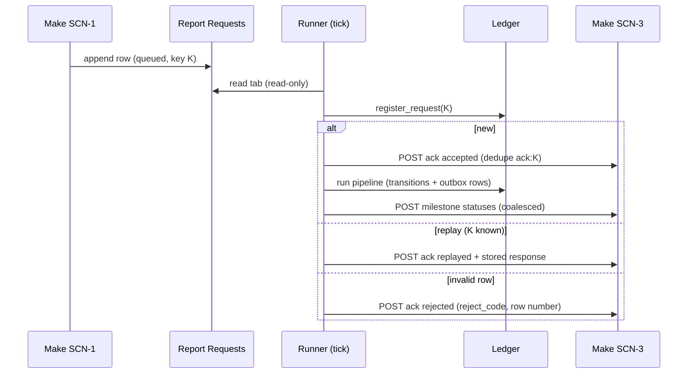
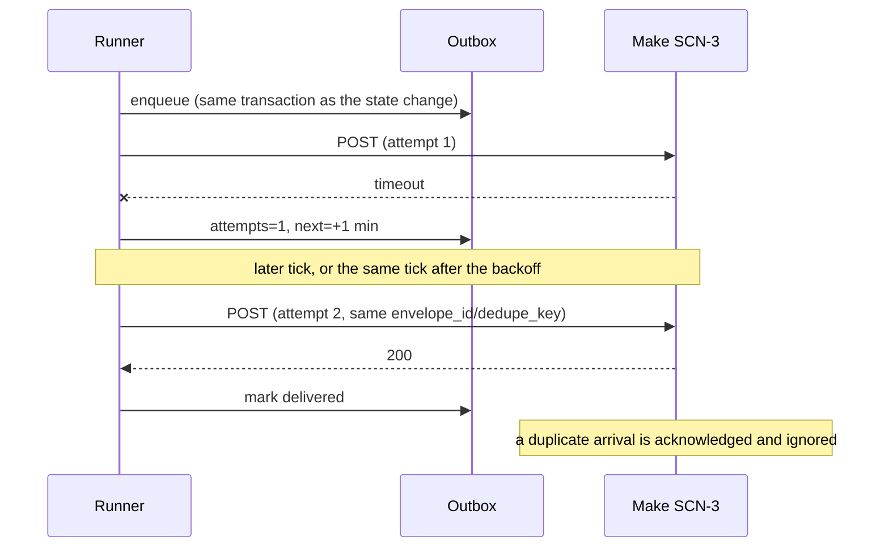
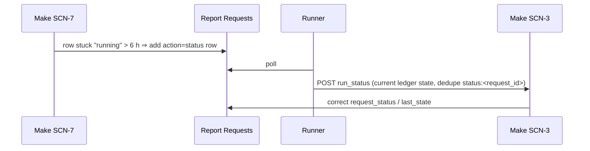

# R8.5 — Communication protocol between Make.com and the local runner

Design only. Labels: *Implemented and tested*, *Designed but not implemented*, *Proposed*, *Unverified*, *Blocked* (see
[r85_make_architecture.md](r85_make_architecture.md) §0). Nothing in this document exists as code except where marked *Implemented*.

## 1. Shape of the protocol

```
Make ──writes rows──▶ Operational workbook ◀──polls (outbound, read-only)── Runner ──POST status (outbound, signed)──▶ Make
```

* **Requests flow through the workbook** (`Report Requests`). The runner **pulls**; nothing pushes into the Windows machine.
* **Status flows through an HTTPS webhook** that the runner **pushes** to. Make never calls the runner.
* **No inbound port, no listener, no tunnel, no port forwarding, no remote-control agent.**
* **Verdict on the approved architecture:** it supports the intended flow end to end. The existing code already provides the hard parts
  (idempotent request registration, a durable transactional outbox, a lease-safe single runner, a replayable response contract). What is
  missing is the plumbing listed in §12.

Implemented today: contracts (`parse_request`, `validate_response`), idempotent `register_request` with stored-response replay, the
`make_status` outbox rows, `runner:global`/`client:*` locks, `recover_interrupted`, retry classification. Everything else here is
*Designed but not implemented*.

## 2. Execution model of the runner (R8.6/R8.7)

A **one-shot "poll" command** started by Windows Task Scheduler every **15 minutes** (and at logon/startup), not a long-running daemon.
Each invocation:

1. Configure logging; take `runner:global` non-blockingly (if another invocation holds it, log `busy` and exit with code 0 — Task Scheduler is
   set to *not start a new instance* anyway).
2. Recover interrupted runs and clear stale leases (existing `recover_interrupted`).
3. **Flush the outbox** (send pending status envelopes, §6).
4. **Read** the three input tabs (`Report Requests`, `Client Delivery Settings`, `Delivery`) with one range read each.
5. Register new request rows, send acks (§5), then **process** accepted requests sequentially (existing `run_batch`), also automatic retries
   that are due (`retry_requests_due`).
6. **Mirror** new `Delivery` outcomes into the ledger (§10).
7. Flush the outbox again; exit.

Why one-shot: no resident process to supervise or leak; Windows restart, sleep and crashes need no special case (the next tick resumes);
logging, leases and the render watchdog already assume per-invocation lifecycles. A long batch (up to `batch_deadline_seconds`, 6 h) simply
keeps the lock, and overlapping ticks exit immediately.

## 3. Polling

| Parameter | Value | Rationale |
|---|---|---|
| Interval | **15 min** | Monthly deliverables are not latency-sensitive; "run now" waits ≤ 15 min. It costs **zero Make operations** (the runner reads Sheets directly). One range read × 3 tabs × 96 ticks = ~290 Sheets reads/day, far under typical per-user quotas (**Unverified** — confirm the current Sheets API quota) |
| Reads per tick | 3 (one per tab, whole range) | Avoids per-row calls; the tabs are small (tens to low hundreds of rows) |
| Backoff on Sheets/network error | 1, 2, 4, 8, 15 min, capped at the normal interval; ±20 % jitter | Prevents hammering during an outage; the next scheduled tick is already ≤ 15 min away, so backoff matters only for in-process retries inside one tick (at most 3 attempts) |
| `auth_required` while reading | stop the tick, send SEV-1 via the status channel, do nothing else | Matches the existing batch-abort rule |
| Ordering | by `(requested_at, client_key, request_id)` | Same as the implemented `run_batch` ordering |
| Large queue | process at most `max_clients` per tick (existing `run_batch` parameter) | Bounds a tick; the rest wait for the next |

## 4. Reading and mapping a request row

For each row the runner builds a `RunRequest` using the existing `parse_request` (closed schema). Mapping is in
[scenario specifications §3](r85_scenario_specifications.md). Rules:

* The workbook is **read-only** for the runner; the runner never writes a cell.
* Cross-checks before the ledger sees the request: header present and unique, types/enums valid, `client_key` in the registry **and** in
  `Client Delivery Settings`, names match, `period_id` equals the reporting workbook's explicit dates (existing `period_differs_from_workbook`),
  `expires_at` not passed (**future** reject code `request_expired`), operator fields present exactly for operator actions (existing).
* A **row that fails these checks** cannot always be a ledger request (its `request_id` may be invalid). It produces an `ack` envelope with
  `decision = rejected`, a fixed `reject_code` (`row_invalid`, `period_invalid`, `client_unknown`, `request_expired`, … — additive codes) and the sheet
  row number — never cell contents. Its outbox dedupe key includes a hash of the row, so the same bad row alerts once, and a corrected row
  (new hash) is evaluated again.
* A row whose `idempotency_key` is already in the ledger with the same client/period/action is a **replay**: answered from the stored
  response, no execution. The same key with a different client/period/action is refused (existing `idempotency_key_reused`).

## 5. Request lease, acknowledgement and exclusivity

* **No lease in the sheet.** The runner cannot write there (and must not: its Sheets scope is read-only), so a "claim row" design is rejected
  (finding F3). **Exclusivity is local:** a single runner instance (`runner:global` lock) and the ledger's unique `idempotency_key`.
  Running two runners against one workbook is **unsupported** (they would not corrupt each other — the ledger is per machine — but they would
  duplicate reports; to be prevented operationally, see the security/reliability doc).
* **Acknowledgement** = an `ack` envelope POSTed right after the request is registered (or refused): `accepted` (new run will follow),
  `replayed` (already known; the stored response is attached), or `rejected` (with a fixed code). Make moves the row to `submitted` /
  `rejected`. The ack is the only "receipt" Make gets; if it is lost the outbox retries it (same `dedupe_key`).
* **Ack timeout on the Make side:** a row still `queued` after 12 h means "not seen" ⇒ runner offline or not polling (SCN-7). This
  distinguishes "not picked up" from "picked up but still working" (`submitted`/`running`).
* **Request expiration:** each row carries `expires_at` (default `requested_at + 7 days`). Past it, the runner refuses (`request_expired`)
  and SCN-7 marks it `cancelled`. Rationale: a monthly report whose operators have long moved on should not run by surprise after an outage;
  7 days covers a long weekend plus repair time; an expired request is simply re-issued with a new key.
* **Duplicate request rows** (Make created twice): same key ⇒ replay; different key, same client/period/action ⇒ the second finds the
  run in progress/complete and is answered `already_complete` or rejected (`run_in_progress`) — no second execution. Different intent
  (e.g. `supersede`) uses its own key grammar.

## 6. Status channel (runner → Make)

### 6.1 Envelope
Every outbound message is a `jasper.status-envelope` v1 ([data contracts](r85_data_contracts.md) §0) carrying one payload of an existing
schema (`jasper.run-response`, `jasper.delivery-ready`) or a small supplementary one. The envelope adds what the payloads lack:
`envelope_id`, `dedupe_key`, `sequence` (the ledger `state_version`, so ordering is exact), `sent_at`, `delivery_attempt`, `runner_id`.

### 6.2 HTTP rules
* `POST https://hook.<region>.make.com/<secret>` (the exact host is the one Make issues; **Unverified**), `Content-Type: application/json`,
  body ≤ 64 KB (real size ≈ 1–2 KB).
* Headers `X-Jasper-Timestamp` (UTC epoch seconds) and `X-Jasper-Signature: v1=<hex HMAC-SHA256(secret, timestamp + "." + raw body)>`.
* TLS certificate verification always on; HTTP (non-TLS) refused by configuration; redirects not followed.
* Timeouts: connect 10 s, total 30 s (a webhook that must answer immediately; 30 s tolerates a cold start; longer would stall the tick).
* One message in flight at a time (sequential) — the volume is tiny and ordering matters.

### 6.3 Delivery guarantees and retry
At-least-once delivery from the outbox, deduplicated at the receiver. Result handling:

| Response | Meaning | Runner action |
|---|---|---|
| `200` | accepted (or duplicate) | mark the outbox row delivered |
| network error, timeout, `5xx`, `408` | transient | keep the row; `attempts + 1`; `next_attempt_at` by the backoff below |
| `429` | rate limited | honour `Retry-After` if present, else backoff |
| `400` | Make rejected the shape/version | keep the row, log `status_rejected` once, **do not retry in a tight loop** (retry after 1 h; likely a contract bug) |
| `401`, `403`, `404`, `410` | secret/URL wrong or scenario removed | open a **circuit**: stop sending for 1 h, log SEV-1 locally; messages are not lost (they wait in the outbox) |

Backoff for transient failures: **1 min, 2 min, 5 min, 15 min, 30 min, then every 60 min** up to **7 days** (then the row is flagged
`undeliverable` locally and a SEV-2 is logged; it is not deleted). Rationale: quick first retries cover blips; the hourly tail keeps
operation counts and log noise low during a long Make outage; 7 days equals the request-expiry horizon.

### 6.4 Coalescing (cost control, finding F5)
The ledger enqueues a `make_status` row on every transition (≈10 per run). The sender sends **milestones** by default and marks the other
rows delivered *locally* (`coalesced`) without a network call:
* always send: ack, `collecting` (first), `rendered`, `audited`, `ready_for_delivery` (+`delivery_ready`), `failed`, `blocked`, `cancelled`, `delivered`;
* skip the transitional rows (`rendering`, `finalizing`, `finalized`, `auditing`, `publishing`) **unless a newer row for the same run is not
  yet sent, in which case only the newest is sent** (state changes are cumulative; the newest carries everything).
A `full` mode (send everything) exists for the pilot. Coalescing is a sender behaviour; the ledger and its outbox are not changed.

### 6.5 Duplicate and out-of-order events
Receiver rule (SCN-3): dedupe on `dedupe_key`; ignore a `run_status` whose `sequence` is lower than the maximum seen for that `run_key`;
never move a `request_status` backwards (`completed` → `running` is impossible). Equal sequences with different content are an anomaly:
alert, keep the first, and let reconciliation (§8) settle it from the ledger.

## 7. Offline and restart behaviour

| Situation | Behaviour |
|---|---|
| **Runner offline for hours** (machine off, no network) | Nothing is lost: rows stay `queued`; on the next tick they are processed oldest first; expired rows are refused; SCN-7 raises `runner_offline` after 12 h (SEV-2) and 24 h (SEV-1) |
| **Windows restart / crash mid-run** | The next tick runs `recover_interrupted`: dead holder + expired lease ⇒ the run returns to its resume state and continues (R8.4.4 rules: liveness conservative, same host); the outbox resumes; no human action |
| **Make unavailable / scenario off** | Status POSTs fail ⇒ outbox backlog; reports continue to be produced and audited; delivery waits (approval cannot happen anyway); backlog is replayed in order after recovery |
| **Make scenario stops midway** (S3 processed half) | The receiver is idempotent per step (dedupe key written **last**, after the row appends, so a half-done execution is re-done on redelivery; appends use the dedupe key as the row key to avoid duplicate rows) |
| **Sheets unavailable** | Polling fails with transient classification; nothing starts; no state is changed; alert only after 3 consecutive ticks (45 min) |
| **Google credentials expired/revoked** | `auth_required` ⇒ batch stops, SEV-1 status event is still sent (the webhook uses no Google credential) |

## 8. Status reconciliation

Three complementary mechanisms; the ledger is the source of truth.

1. **Outbox replay** (automatic) closes gaps caused by Make outages.
2. **`status` request** (Make-initiated, read-only): SCN-7 writes a `Report Requests` row with `action = status` (key
   `status:<client_key>/<period_id>:<minute>`) for any row stuck in `submitted/running`. The runner answers with the **current** `run-response`
   in a `run_status` envelope whose `dedupe_key` is `status:<request_id>` (distinct from state-change keys). Make then corrects its mirror.
   No run is started or modified by a `status` request.
3. **Terminal sweep** (runner-initiated, **Proposed**): once per day the sender re-sends the current terminal status of runs whose last
   *delivered* envelope is older than their ledger state, to heal any lost-forever message (e.g. after an `undeliverable` flag).

**Disagreement rules.**

| Disagreement | Winner | Action |
|---|---|---|
| Sheet says `queued`; ledger has the request registered | ledger | next envelope updates the sheet |
| Sheet says `running`; ledger says `failed`/`blocked`/`audited` | ledger | reconciliation envelope; Make corrects |
| Sheet `request_status = completed`; ledger has no such run | investigate | SEV-2; likely a wrong `client_key`/period mix-up, never auto-fixed |
| `Execution History` missing an event the ledger has | ledger | replay; history is append-only, so the late row is appended with its true `sequence` |
| `Delivery` says `sent`; ledger run not `delivered` | `Delivery` (for delivery facts) | the mirror records `delivered` |
| `Delivery` says `approved`; ledger audit/upload not confirmed for that hash | **neither delivers**: SCN-6's own re-check fails, SEV-2 | investigate; the ledger's upload confirmation is required for G3 |
| Request row edited after creation | the original (ledger) | `idempotency_key_reused` ⇒ SEV-3 |

## 9. Sequences

### 9.1 Request lifecycle


### 9.2 Status failure and recovery


### 9.3 Reconciliation


## 10. Delivery mirror (runner reads `Delivery`)

On each tick the runner reads `Delivery` and, for rows whose `delivery_key` belongs to a run in `ready_for_delivery`, records approval/
delivery outcomes into `ledger.deliveries` (existing table; the `mirrored_at` column exists for this) and, when `delivery_status = sent` for
that exact `pdf_sha256`, moves the run to `delivered` (existing state). It never writes the sheet, never approves, never sends. If the row's
`pdf_sha256` differs from the ledger's confirmed upload for that key, nothing is recorded and a SEV-2 anomaly is logged.

## 11. Parameter summary with rationale

| Parameter | Value | Rationale (short) |
|---|---|---|
| Poll interval | 15 min | latency-insensitive; free in Make ops |
| Status POST timeout | 10 s connect / 30 s total | immediate-ack webhook; bounded tick |
| Outbox backoff | 1,2,5,15,30,60 min… | quick for blips, quiet for outages |
| Outbox horizon | 7 days | equals request expiry |
| Request expiry | 7 days | covers outages; bounds surprise runs |
| "Not picked up" alarm | 12 h / 24 h | two missed working days at most; 12 h ≈ one night |
| "Stuck running" check | 6 h | `batch_deadline_seconds` default |
| Approval reminder / expiry | 3 d / 14 d | human review scale (R8.2 default 14 d) |
| e-mail retry | 15 min, 1 h, 4 h | transient provider errors |
| Ambiguous `sending` | 15 min | no automatic resend after that |
| Watchdog | every 4 h | detection in hours is enough; SEV-1 events are pushed instantly |
| Timestamp tolerance | 5 min | replay protection vs clock drift (the runner should also sync time) |

All values are initial proposals for configuration, not constants of nature; they are to be confirmed during the R8.7 pilot.

## 12. Runner-side requirements created by this protocol (none exist yet)

R8.6: CLI `poll`/`run`/`status`/`dry-run`/recovery commands, production `collect` factory, credentials directory support, logging
activation, in-runner asset preflight. R8.7: Sheets reader for the three tabs, row → `RunRequest` mapper with the additive reject codes
(`row_invalid`, `period_invalid`, `request_expired`, `target_not_latest`), ack emission at registration, the HTTP sender with HMAC, backoff, circuit
and coalescing, `status`-request answers, secret loading (webhook URL and signing key from a local secret store), additive optional
`options.target_run_key`. R8.8: publisher, `publish` action, manifest. R8.9: `Delivery` mirror and the transition to `delivered`.
