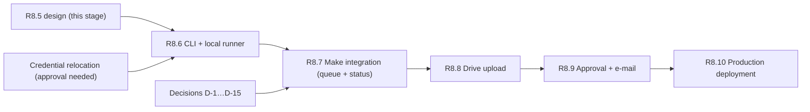

# R8.5 — Implementation roadmap, dependencies, decisions and final review

Design only. Labels: *Implemented and tested*, *Designed but not implemented*, *Proposed*, *Unverified*, *Blocked*. This roadmap supersedes the stage
numbering of the R8.2 roadmap for everything after R8.4 (see the status block in [implementation_roadmap.md](implementation_roadmap.md)).
**No stage after R8.5 has been started or approved.**

## 1. Stage map

## 2. R8.5 — current stage (Make.com architecture and design only)
Delivered: the seven `r85_*` documents; consistency tests for the documents and the contract examples. Not delivered (by design): any code, any
Make/Google/Drive/e-mail contact. **Exit:** reviewed and approved by the owner.

## 3. R8.6 — CLI and local runner
| Item | Detail | Label |
|---|---|---|
| CLI entry point | `python -m seo_report` with sub-commands: `clients`, `validate`, `dry-run`, `run`, `batch`, `status`, `retry`, `acknowledge`, `cancel`, `supersede`, `recover`, `poll` (stub until R8.7), `auth setup` (exists), `preflight` | Designed but not implemented |
| Real Google client factory | builds Sheets/Search Console/GA4 clients through `auth.get_credentials()` (non-interactive) and passes them to `source_collector`; the `Services.collect` for production | Designed but not implemented |
| Credentials path support | configurable credentials directory (default `%LOCALAPPDATA%\JasperSEOReporting\credentials`), validated like the other paths (canonical, outside project/OneDrive) | Designed but not implemented |
| Safe configuration validation | load `runner.yaml`, run the existing checks, print the codes, never values | Designed but not implemented (loader exists) |
| Client listing | list clients, periods and rejection codes from the workbook (read-only) | Designed but not implemented |
| Dry run, single-client run, batch run | wrap `run_client(mode="dry_run")`, `run_client`, `run_batch` | wrappers new; logic *Implemented and tested* |
| Recovery commands | wrappers over acknowledge/cancel/supersede/retry and `recover_interrupted` | wrappers new |
| Status inspection | read the ledger (read-only connection) and print validated responses | new |
| Logging activation | call `configure_logging` at start | new (function exists) |
| In-runner asset preflight | reuse `scripts/check_deployment.py` logic before any collection | new |
| Listener check | source/runtime test that no listening socket is opened | new test |
**Prerequisites:** R8.5 approved. **Blockers:** credential relocation is *not* needed to build, but is needed before real data is used from a scheduled account;
the OAuth consent-screen status must be checked by a person (Unverified); a clean install on the target machine (Unverified).
**Exit criteria:** attended single-client run on a real client period producing an audited PDF that a person reviews; recovery commands rehearsed on test data;
logs active and clean; preflight green.

## 4. R8.7 — Make.com integration (queue, status, pilot)
| Item | Detail | Label |
|---|---|---|
| Operational workbook | created and shared by a person (4 tabs + the additions in the scenario specifications), protected ranges | Designed but not implemented |
| Request polling | Sheets reader for the three tabs, row → `RunRequest` mapper, additive reject codes, `options.target_run_key`, `request_expired` | Designed but not implemented (small additive contract changes with tests) |
| Acknowledgement | `request_ack` emission at registration | Designed but not implemented |
| Outbound status webhook | envelope, HMAC signing, timeouts, backoff, circuit, coalescing, `status`-request answers, secret loading | Designed but not implemented |
| Idempotency | already in the ledger; new dedupe keys for acks/reconciliation | partly *Implemented* |
| Make scenarios | SCN-1, SCN-3, SCN-7 (SCN-4A/4B/6 skeletons disabled) built in a **test** Make workspace with a test client | Designed but not implemented |
| One-client pilot | one real or synthetic client end to end up to `audited`, no delivery | Designed but not implemented |
**Prerequisites:** R8.6 complete; Make account/plan verified (**Unverified**); decisions D-4, D-6, D-7, D-8, D-9, D-14 settled; webhook and secrets created **by a person**;
the operational workbook exists. **Blockers:** the owner's explicit approval to connect Make.com; any change to the runner's Google scopes (none needed in this stage).
**Exit criteria:** ack + milestone round trip; duplicate polling drill (same row twice → one run); offline drill (stop the runner 2 h → recovers, no loss); Make-outage drill
(disable the receiver → backlog replays); duplicate-event test; no inbound port; no secret in sheets/logs; operations measured against §3 of the cost document.

## 5. R8.8 — Google Drive integration
| Item | Detail | Label |
|---|---|---|
| Publisher | the `publishing` stage: preconditions, folder creation, lookup-before-upload, resumable upload, size/MD5/parent verification, manifest, one-transaction record, `delivery-ready` | Designed but not implemented |
| `publish` action | accepted for retry after `publish_failed`; refresh after recipient change | Designed but not implemented |
| State reach | pipeline reaches `ready_for_delivery` (today stops at `audited`) | Designed but not implemented |
| Delivery manifest | schema `jasper.delivery-manifest` v1 (R8.2) | Designed but not implemented |
| Source check | tests that the Drive code path has no delete/overwrite call | Designed but not implemented |
**Prerequisites:** R8.7 complete; decisions D-1, D-2, D-3, D-10 settled; **a new OAuth consent for a Drive write scope** (a deliberate, owner-approved Google Cloud action;
preferably a separate token). **Blockers:** that approval; Unverified behaviours of `drive.file` (folder visibility, sharing with Make's account).
**Exit criteria:** upload of a test PDF and of a replacement (distinct file, old one kept); interrupted-upload recovery without a duplicate; hash/size/MD5 confirmed;
`delivery-ready` accepted by SCN-3/SCN-4A in the test workspace.

## 6. R8.9 — Approval and e-mail delivery
| Item | Detail | Label |
|---|---|---|
| Approval workflow | SCN-4A/4B, protected ranges, `approved_pdf16` confirmation, expiry, supersession rule | Designed but not implemented |
| Recipient validation | `Client Delivery Settings`, `recipient_set_hash16`, change detection | Designed but not implemented |
| E-mail delivery | SCN-6, template, attachment (or link, D-5), claim-before-send, ambiguity guard, retries | Designed but not implemented |
| Delivery tracking | `Delivery` rows, `Execution History`, runner mirror → `delivered` | Designed but not implemented |
**Prerequisites:** R8.8 complete; decisions D-4, D-5, D-11, D-12 settled; sending mailbox and Make's Gmail connection created by a person; client/recipient list and
consent for automated delivery confirmed by the business; template text approved. **Blockers:** owner approval to send mail; legal/privacy review of Make processing the PDF (Unverified).
**Exit criteria:** full cycle to an **internal** test recipient; negative tests: unapproved, wrong hash, expired approval, changed recipients, duplicate trigger, ambiguous send — none delivers.

## 7. R8.10 — Production deployment
Windows Scheduled Task (every 15 minutes + at startup; run-as the credentials account; do-not-start-new-instance), monthly operation calendar, monitoring and alert routing
(SCN-7, optional heartbeat), backups (ledger, history, output, **offline** copy) with a restore test, recovery runbook and drills, credential relocation completed and old
copies retired (see the credential procedure), Make plan sized from measured operations, controlled expansion (1 client → 3 → all active clients), an incident and
change-management routine. **Prerequisites:** R8.9 complete; credential relocation executed; backups tested. **Blockers:** every deployment-readiness item marked Blocked or Needs implementation.
**Exit:** two consecutive monthly cycles with no manual intervention other than approvals.

## 8. Unresolved decisions (each needs an owner's answer; recommendation given)

| ID | Decision | Recommendation | Needed by |
|---|---|---|---|
| D-1 | Who uploads to Drive | the **runner** (the only component that can read the PDF; consistent with R8.2) — Make only verifies | R8.8 |
| D-2 | Drive write credentials | a **separate token/consent**, keeping the reporting token read-only | R8.8 |
| D-3 | Drive root folder creation and visibility (`drive.file`) | the runner creates the root, shares it with Make's account and the reviewers; verify the sharing capability first; otherwise a narrowly-scoped dedicated account on a Shared Drive | R8.8 |
| D-4 | Notification channel and groups | e-mail to an operator group first (chat later); SEV-1 also to a second address | R8.7 |
| D-5 | Attach the PDF or send a restricted Drive link | **attach** (clients rarely have Google accounts), accept Make processing and verify its retention settings; reconsider if privacy review objects | R8.9 |
| D-6 | Make plan, status mode | choose the plan from measured operations; start in `full` mode for the pilot, `milestones` in production | R8.7 |
| D-7 | Make's read access to the reporting workbook vs an operator-maintained mirror of period dates | read-only view access to the `Client Configuration` tab for the Make user (no write) | R8.7 |
| D-8 | Location, owner and sharing of the operational workbook | a Workspace-owned file, separate from the reporting workbook, sharing by named users/groups only | R8.7 |
| D-9 | Make connection owner and sending mailbox | dedicated Workspace users, not personal accounts | R8.7 |
| D-10 | Retention of Drive files and manifests | ≥ 24 months (R8.2 default); manual, logged cleanup | R8.8 |
| D-11 | Approval hardening | confirmation code (`approved_pdf16`) now; revision-author allow-list later if Make/Sheets allow | R8.9 |
| D-12 | Whether the report e-mail uses the Project Manager as Reply-To | not by default; `Manager Email` is the sender's contact in the PDF, never a recipient; a Reply-To would be a separate, explicit setting | R8.9 |
| D-13 | Adopt the runner heartbeat | yes, daily (cheap, closes the "silent runner" gap) | R8.7 |
| D-14 | Timing parameters (poll 15 min, expiry 7 d, alarms 12 h/24 h, approval 3 d/14 d, watchdog 4 h) | adopt as initial values, tune after the pilot | R8.7 |
| D-15 | Reporting frequency | pilot supports `every_28_days` and `manual` only (R8.2); calendar-month reporting is out of scope | R8.7 |

## 9. Design conflicts found and how each is resolved

| ID | Conflict | Resolution |
|---|---|---|
| C1 | The R8.5 brief lists "Google Drive upload" among Make's scenarios; R8.2 (approved) says the **runner uploads** | The runner uploads; Make verifies and consumes. A Make-side upload is impossible without a reachable PDF (no inbound port) |
| C2 | R8.2 request actions include `dry_run`/`publish`; code rejects both today | `dry_run` stays local; `publish` is added in R8.8 |
| C3 | R8.2 `rankings_ready` request column vs the implemented request contract | Make-side gate (two plain settings columns); no contract change |
| C4 | R8.2 "claim"/lease semantics vs a read-only runner | no sheet claim; local exclusivity + ledger idempotency; acknowledgement by webhook |
| C5 | R8.2 forbids formulas in columns Make reads; a "due" flag would be convenient | avoided: the operator sets a plain flag, Make writes a plain marker |
| C6 | R8.2 roadmap placed the CLI in R8.4; R8.4 became reliability work | CLI moves to R8.6 |
| C7 | Outbox payload lacks `state_version`/`outbox_id` for dedupe | transport envelope; `run-response` untouched |
| C8 | Outbox writes a row on every transition | sender-side coalescing |
| C9 | `delivery_key` embeds the recipient hash, requiring the runner to read recipients | read-only read of `Client Delivery Settings`; recipient change handled by cancel + `publish` refresh |
| C10 | A repeated `supersede` with a new key would create another generation | deterministic key grammar + additive `options.target_run_key` |
| C11 | "Ready for approval" in the brief vs state names | maps to `ready_for_delivery` (no new status name) |

## 10. Final review (the 10 required checks)

| # | Check | Result |
|---|---|---|
| 1 | Cross-check against the actual R8.3/R8.4 implementation | Done: baseline table in [the architecture document §1](r85_make_architecture.md); contract examples that reuse existing schemas are validated by code in `tests/test_r85_documents.py` |
| 2 | No Make action assumes an existing CLI or client factory | Every runner-side step is labelled *Designed but not implemented* and assigned to R8.6/R8.7; Make scenarios depend only on rows and webhooks |
| 3 | Request/response contract compatibility | `jasper.run-request`, `jasper.run-response`, `jasper.delivery-ready` reused unchanged; only additive items are proposed (envelope, ack, `options.target_run_key`, reject codes, `drive_md5`) |
| 4 | Approval tied to the exact PDF hash | `Delivery` row keyed by `delivery_key` (contains `pdf16`), stores `pdf_sha256`; reviewer confirms `approved_pdf16`; SCN-6 re-checks against the Drive file property and the ledger-confirmed upload; a different hash needs a new row and a new approval; older pending rows are expired when a newer PDF appears |
| 5 | Delivery blocked until finalization, audit and approval | six gates G1–G6 ([architecture §8](r85_make_architecture.md)); `delivery-ready` cannot describe a failed audit (validator); SCN-6 has no entry point except an approved key and re-verifies |
| 6 | The local ledger remains authoritative | authority model in the architecture §4 and reconciliation rules in the protocol §8; the sheets are mirrors |
| 7 | No inbound local port | no listener anywhere in the design; polling and webhook are outbound; a verification step is part of the security checklist and R8.6 tests |
| 8 | Unresolved decisions | §8 (D-1…D-15) |
| 9 | Design conflicts | §9 (C1…C11) |
| 10 | Prerequisites for R8.6, R8.7 and later | §3–§7 |

## 11. Known risks of this design
Make capabilities and limits are unverified; Drive scope behaviour is unverified; at-least-once e-mail; sheet-based approval is editable by editors; PDF transits Make;
credentials still inside OneDrive until approved relocation; a single runner machine; polling latency of up to 15 minutes; operations cost estimates are unmeasured;
the Windows machine, Chromium and Google sign-in status all must be healthy for monthly runs.
