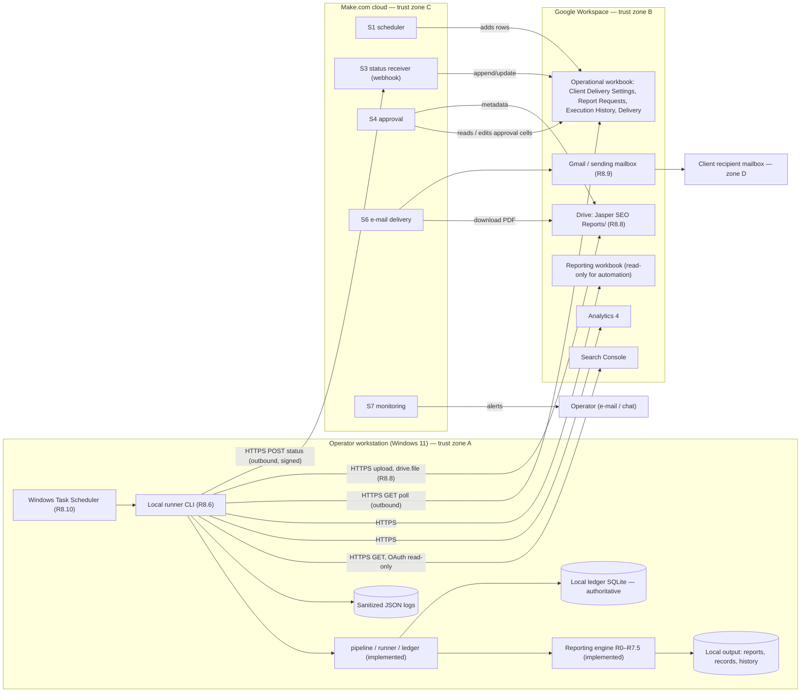
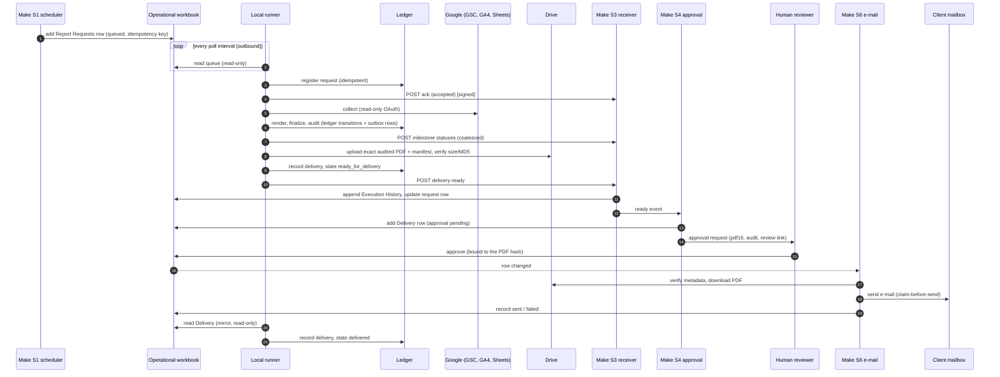
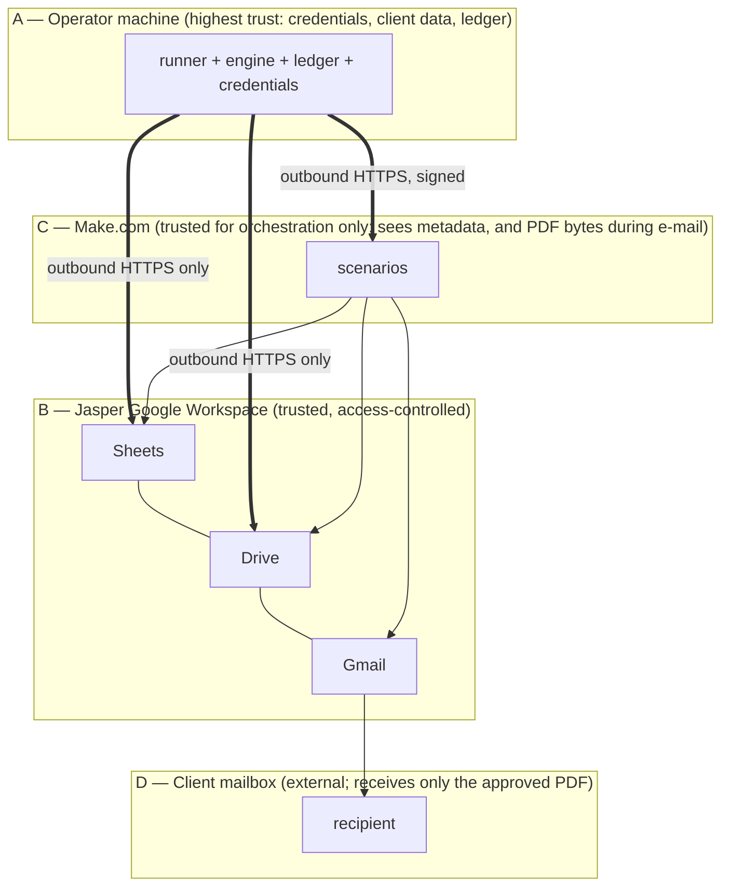

# R8.5 — Make.com integration architecture

**Stage:** R8.5, design only. **Date:** 2026-10-31. Nothing described here has been built, connected, created or called: no Make.com
login, scenario, webhook or connection; no Google API call; no Sheets edit; no Drive upload; no e-mail; no source change.

Companion documents: [scenario specifications](r85_scenario_specifications.md) ·
[communication protocol](r85_communication_protocol.md) · [data contracts](r85_data_contracts.md) ·
[security and reliability](r85_security_and_reliability.md) · [implementation roadmap](r85_implementation_roadmap.md) ·
[cost and operations](r85_cost_and_operations.md).
Background: [as_built_status](as_built_status.md), [execution_contract](execution_contract.md), [ledger_schema](ledger_schema.md),
[google_sheets_contract](google_sheets_contract.md), [delivery_architecture](delivery_architecture.md), [make_scenarios](make_scenarios.md).

## 0. Capability labels used in all R8.5 documents

| Label | Meaning |
|---|---|
| **Implemented and tested** | Exists in `src/` and is covered by offline tests (verified against the code for this document) |
| **Designed but not implemented** | Specified here (or in R8.2) in enough detail to build; no code |
| **Proposed** | A recommendation that needs a decision or an approval before it becomes a design |
| **Unverified** | Depends on a fact about Make.com, Google or Windows that has not been checked against current documentation or a live system |
| **Blocked** | Cannot start until a named prerequisite is complete or approved |

## 1. Baseline, verified against the code (not assumed)

| Fact | Verified how | Status |
|---|---|---|
| Request/response/batch/delivery-ready contracts (version 1, closed schemas) | `contracts.py` (`parse_request`, `validate_response`, `validate_batch_summary`, `validate_delivery_ready`) | Implemented and tested |
| Actions `validate, dry_run, run, retry, publish, status, acknowledge, cancel, supersede` are *parsed*; `dry_run` is **rejected** as a ledger request (`action_not_supported`) and `publish` is **rejected** (`publish_not_supported`) | `pipeline._production` | Implemented and tested |
| State machine to `audited`; `publishing`, `ready_for_delivery`, `delivered` exist but are never reached | `contracts.TRANSITIONS`, `pipeline` | Implemented and tested (reach: `audited`) |
| Ledger: requests (idempotent by `idempotency_key`), runs with generations, attempts, append-only events, locks, `deliveries` table, `outbox` table | `ledger.py` | Implemented and tested |
| Outbox rows (`make_status`, payload = a validated `jasper.run-response`) are written inside the transition transaction, one per state change; **no code reads them to send** | `ledger.transition(outbox=...)`, `pending_outbox`, `mark_outbox_delivered` | Implemented and tested (producer only) |
| `deliveries` rows can be recorded (`record_delivery`) but no caller exists | `ledger.py` | Implemented and tested (API only) |
| Reporting workbook read (two tabs), per-client rejection codes, explicit 28-day period | `client_loader.py` | Implemented and tested offline |
| Source errors classified; `auth_required` stops a batch | `source_collector.py`, `runner.py` | Implemented and tested |
| Non-interactive credentials; explicit setup command | `auth.py` | Implemented and tested (synthetic) |
| Sanitized JSON logging | `runner.configure_logging` | Implemented and tested; **not activated** |
| CLI / entry point | none | **Designed but not implemented** (R8.6) |
| Real Google client factory for `Services.collect` | none | **Designed but not implemented** (R8.6) |
| Request intake from a sheet / queue | none | **Designed but not implemented** (R8.7) |
| Status sender (outbound HTTPS), acknowledgement sender | none | **Designed but not implemented** (R8.7) |
| Drive upload, delivery manifest, approval, e-mail | none | **Designed but not implemented** (R8.8–R8.9) |
| Any Make.com scenario, webhook, connection | none | **Designed but not implemented** |
| Credentials location inside OneDrive | `auth.TOKEN_PATH` etc. | **Blocked** (relocation needs approval) |

## 2. Architecture principles

1. **The local ledger is the authoritative record of execution** (what ran, what was finalized, what the audit said, what PDF
   exists). Make.com and the sheets hold *derived mirrors* and *human/outside facts* (approval, e-mail result).
2. **Make orchestrates and notifies; it never executes Python and never reaches into the Windows machine.** All local ↔ cloud traffic
   is initiated by the runner (outbound HTTPS). **No inbound port is opened.**
3. **Report generation and delivery are separate workflows** joined only by one verified artefact: an audited PDF identified by its
   SHA-256, uploaded to Drive and described by a `jasper.delivery-ready` message.
4. **Nothing reaches a client without** (G1) finalization, (G2) a passing audit, (G3) a verified Drive upload of the exact PDF,
   (G4) a human approval bound to that PDF's hash, (G5) a validated recipient from the operational workbook, (G6) an unclaimed
   delivery key. Each gate is checked again by the next component (see §8).
5. **Automation never deletes or overwrites** a report, record, Drive file or sheet row (existing R8.4 rule, kept).
6. **Idempotency everywhere**: request key, outbox dedupe key, delivery key, claim-before-send.
7. **Contracts are reused**: no new state names, no new error categories; additions are additive optional fields or new, clearly
   separated message kinds.
8. **Low operations cost**: the runner does the polling (free in Make operations); Make is event-driven and coalesced.

## 3. High-level architecture

Text version of the same picture: `Make → (writes rows) → operational workbook ← (runner polls, read-only) ← runner → (POST status) → Make`;
`runner → Drive (uploads the audited PDF)`; `Make → Drive (reads it) → Gmail → client`, only after a human approves the exact hash.

## 4. Component responsibility matrix

| Responsibility | Local runner / engine | Make.com | Operational workbook | Drive | Gmail | Operator |
|---|---|---|---|---|---|---|
| Monthly schedule, due-client selection | — | **owns** (S1) | holds settings | — | — | sets client/period dates, rankings-ready flag |
| Client validation (registry, dates, rankings) | **owns** (loader, registry, 28-day rule) | pre-checks only (status, flags) | — | — | — | fixes data |
| Request creation | — | **owns** (S1), operator may add rows | stores rows | — | — | manual/replacement requests |
| Request intake, idempotency, ordering | **owns** (ledger) | — | queue (read-only for runner) | — | — | — |
| Collection from GSC/GA4/Sheets | **owns** | — | — | — | — | — |
| Rendering, finalization, audit | **owns** (unchanged engine) | — | — | — | — | resolves blocked runs |
| Execution state of record | **owns** (ledger) | mirror (`Execution History`, `request_status`) | mirror | — | — | — |
| Status/ack emission | **owns** (outbox sender, R8.7) | **receives** (S3) | — | — | — | — |
| Drive upload + hash confirmation | **owns** (publisher, R8.8) | verifies metadata (S4) | — | stores | — | — |
| Approval | **never** approves | **enforces** (S4) | stores decision | — | — | **decides** |
| Recipient list | validates shape/hash | **reads** | **owns** (`Client Delivery Settings`) | — | — | maintains |
| E-mail delivery | **never sends** | **owns** (S6) | stores result | source of PDF | sends | confirms ambiguous sends |
| Delivery result of record | mirrors read-only (→ `delivered`) | **writes** | **owns** (`Delivery`) | — | — | — |
| Notifications / escalation | logs only | **owns** (S7) | — | — | — | acts |
| Credentials (Google read, Drive write) | **holds** (local, per account) | holds its *own* Google/Gmail connections only | — | — | — | rotates |
| Logs | **owns** (sanitized, local) | Make execution logs (data minimised) | — | — | — | reviews |

**Authority model.** *Report facts* (state, attempts, hashes, audit, upload confirmation): ledger. *Human and delivery facts*
(approval, e-mail result): the `Delivery` tab, mirrored read-only into `ledger.deliveries` by the runner so the local record is complete
(and so `ready_for_delivery → delivered` is recorded). *Request intent*: `Report Requests` rows; the ledger decides what actually ran.
When a mirror disagrees with the ledger about a report fact, **the ledger wins**; when the ledger disagrees with `Delivery` about
approval or sending, **the `Delivery` tab wins** (the runner cannot know). See the protocol document §9.

## 5. Data-flow diagram (monthly happy path)

## 6. Trust boundaries

| Boundary crossed | Data that crosses | Protection | Must **never** cross |
|---|---|---|---|
| A → Google APIs | OAuth-authorised read requests (GSC, GA4, Sheets); later Drive upload | TLS, OAuth scopes (read-only now), per-account credentials | tokens, client secrets in any payload |
| A → Make webhook | Status envelopes (ids, states, hashes, fixed codes) | HTTPS, secret URL + HMAC signature + timestamp, no PDF, no client data | file paths, exception text, recipients, tokens, Drive links |
| Make ↔ Sheets/Drive | rows, file metadata, the PDF bytes (download for e-mail) | Make's own Google connection with narrow rights | runner secrets |
| Make → Gmail → client | the approved PDF attachment, fixed-template text | approval + recipient gates | other clients' data, internal ids beyond the file name |
| Make → operator | notifications with ids and codes | data minimisation (see security doc §8) | recipients' addresses, links in broad channels, hashes beyond `pdf16`, secrets |
| B ↔ A (reverse) | **nothing**: no inbound connection to the runner exists | no listening socket, no port forwarding | — |

## 7. Dependencies between components

| Component | Needs | Needed by |
|---|---|---|
| S1 scheduler | operational workbook tabs, `config/clients.yaml` key mirror in `Client Delivery Settings`, Make Google connection | runner (requests) |
| Request intake (runner) | CLI (R8.6), Sheets read of the operational workbook, mapping row → `RunRequest`, contract additions (§9) | pipeline |
| Status sender (runner) | outbox (exists), webhook URL + signing secret in a local secret store, coalescing rule, ack emission | S3, S7 |
| S3 receiver | webhook, secret, dedupe store, `Execution History` | S4, S7, operator |
| Drive publisher (runner) | Drive write scope (new OAuth consent: **not approved**), manifest, pipeline `publishing` stage, extension of the state machine's reach | S4, S6 |
| S4 approval | `jasper.delivery-ready`, recipients, Drive metadata read | S6 |
| S6 e-mail | approval, Drive download, Gmail connection, template | `Delivery` mirror → `delivered` |
| Delivery mirror (runner) | Sheets read of `Delivery`, `ledger.record_delivery`, a pipeline transition to `delivered` | ledger completeness |
| Credentials relocation | approval, configurable credentials directory (code) | every Google access of the runner |
| Logging activation | CLI | all of the above |

Critical path: **R8.6 (CLI, client factory, credentials path) → R8.7 (queue + status) → R8.8 (Drive) → R8.9 (approval + e-mail) → R8.10 (production)**.

## 8. Delivery eligibility — six gates, each re-checked downstream

| Gate | Checked by | Re-checked by | Evidence |
|---|---|---|---|
| G1 finalized | engine / `finalize_service` | Drive publisher (record + hashes) | ledger `finalized`, reviewer record |
| G2 audit passed | `audit_service` gate (mandatory, cannot be bypassed even after an operator acknowledgement) | publisher; `jasper.delivery-ready` can only *describe* a passed audit (`validate_delivery_ready` refuses otherwise) | `audit.outcome = consistent`, `verification_complete = true`, `finalized_valid ≥ 1` |
| G3 exact PDF uploaded and verified | runner publisher | S4 (Drive metadata: size, parent, `pdf_sha256` property, MD5) | `delivery-ready.pdf_sha256` |
| G4 approved, bound to the hash | S4 | S6 immediately before sending | `Delivery.pdf_sha256` = file property = message hash; confirmation code `approved_pdf16` matches |
| G5 recipient valid | S4 | S6 | `recipient_set_hash16` equals the `delivery_key` suffix |
| G6 delivery key unclaimed | S6 claim | S6 ambiguity guard | `delivery_status` transitions `not_started → sending → sent` |

A replacement report (a new generation, R8.4.2) has a different PDF hash, hence a new `delivery_key`, hence needs its own G3–G6. A
previously approved hash never authorises another hash.

## 9. Findings from evaluating the approved architecture against the code

Verdict: **the approved architecture (Make writes rows → runner polls outbound → runner POSTs status → Make approves and delivers) is
supportable**, and needs no inbound port. It exposes the following conflicts and gaps, all recorded for R8.6–R8.9:

| # | Finding | Resolution in this design | Label |
|---|---|---|---|
| F1 | The R8.2 sheet lists `dry_run` as a request action; the implemented pipeline **rejects** `dry_run` as a ledger request (dry runs are a local `mode`) | Make never creates `dry_run` rows. Dry run stays a local operator CLI command (R8.6) | Conflict resolved by design |
| F2 | The R8.2 sheet has a `rankings_ready` column; the implemented request contract has no such field | Gate it **on the Make side**: S1 creates `run` rows only when the operator flag is TRUE. The runner independently rejects missing/invalid rankings through `client_loader` codes. No contract change | Conflict resolved by design |
| F3 | R8.2 describes a runner that "claims" rows; the runner's Sheets scope is **read-only** and must stay so | No claim in the sheet. Exclusivity = one runner instance (`runner:global` lock) + ledger idempotency. Acknowledgement travels by webhook | Conflict resolved by design |
| F4 | The outbox payload is a bare `jasper.run-response` with no `state_version`/`outbox_id`, which the R8.2 dedupe needs | Wrap it in a transport **envelope** (`jasper.status-envelope`), leaving `run-response` untouched | Designed but not implemented |
| F5 | The outbox enqueues a row on **every** transition (about 10 per run) | Sender **coalesces**: sends only milestones by default; coalesced rows are marked delivered locally | Designed but not implemented (changes `ledger`/sender) |
| F6 | No acknowledgement exists: `create_run` enqueues nothing | Sender emits an `ack` envelope at request registration (accepted / rejected / replayed) | Designed but not implemented |
| F7 | Drive upload by the runner needs a **Drive write scope**; the OAuth scopes today are read-only and must not change silently | New, separate consent, preferably a **separate token** so the reporting token stays read-only; needs explicit approval | **Blocked** (approval) |
| F8 | `jasper.delivery-ready.delivery_key` includes `recipient_set_hash16`, so the **runner** must read `Client Delivery Settings` | Read-only read of that tab (same Sheets scope); a recipient change after readiness cancels the old delivery row and needs a `publish` refresh request | Designed but not implemented |
| F9 | Requests cannot name which run a `supersede` targets (R8.4.2 limitation: a second supersede with a new key makes another generation) | Deterministic idempotency key `supersede:<run_key>:g<generation>` **and** an additive optional `options.target_run_key` verified against the latest run | Designed but not implemented (additive contract change) |
| F10 | `request_expired` does not exist as a reject code | Additive reject code + `expires_at` column; Make also expires rows | Designed but not implemented |
| F11 | Runner offline is invisible to Make (no events) | Optional daily `runner-heartbeat` envelope + Make-side "queued too long" check | Proposed |
| F12 | `ready_for_delivery` is reached only after the Drive upload (R8.2 semantics) — "ready for approval" in the product workflow maps to this state | Keep names; document the mapping | Resolved by design |
| F13 | `status` requests are read-only and exist: a good reconciliation primitive, but the outbox dedupe key is per state change | Reconciliation envelopes use a different dedupe key (`status:<request_id>`) | Designed but not implemented |
| F14 | The PDF passes through Make during e-mail attachment | Accept and document, or switch to a restricted Drive link (decision D-5) | Unresolved decision |
| F15 | Make cannot compute SHA-256 over file bytes reliably (**Unverified**) | Trust the chain: runner verifies SHA-256 locally, stores it as a Drive property and in the manifest; Make compares the property, size and Drive's MD5 | Unverified |

## 10. What this stage does not decide (see the roadmap for the full list)

Whether notifications use e-mail or chat; whether the Drive write uses a separate token; attachment versus link; the exact Make plan
and its limits; the operational workbook's location and sharing; the Make connection owner account. All are listed with a
recommendation in [r85_implementation_roadmap.md](r85_implementation_roadmap.md) §7.
